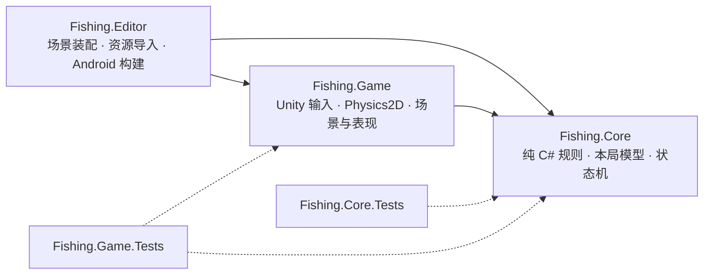
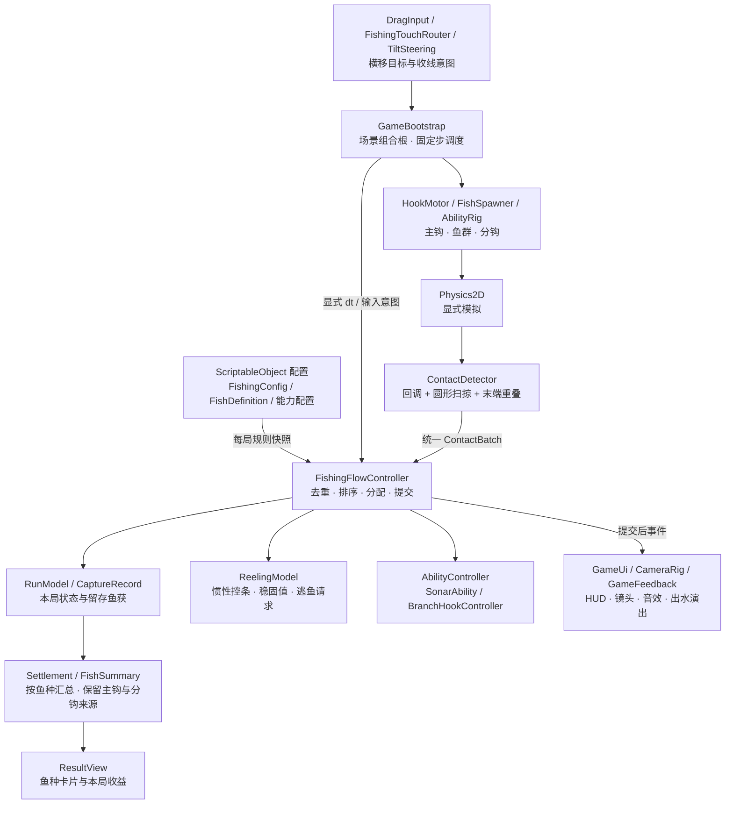
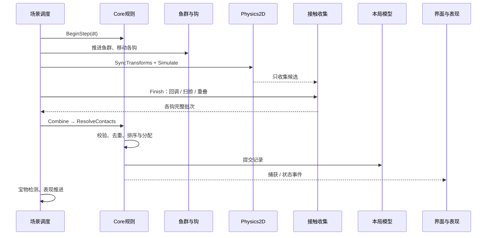
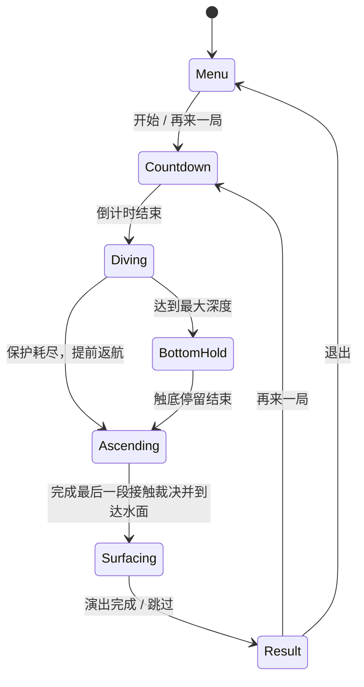

# Fishrise 架构图谱

[返回项目首页](../../README.md) · [运行与构建](Running.md) · [验证与限制](Verification.md)

本文按 2026-10-26 源工程整理。图中的类名均对应当前实现；数据流箭头和程序集依赖分别说明。

## 1. 程序集边界

- `Fishing.Core.asmdef` 设置 `noEngineReferences: true`。Core 不读取 `Time`、`Input`、`Physics2D`、GameObject 或 ScriptableObject。
- `Fishing.Game` 引用 Core，把 Unity 输入和物理结果转换成规则数据。Core 不反向引用 Game。
- Editor 工具独立放在 Editor 程序集中；运行时程序集不包含 UnityEditor 代码。

入口：[Core asmdef](../../Assets/_Game/Scripts/Core/Fishing.Core.asmdef) / [Game asmdef](../../Assets/_Game/Scripts/Game/Fishing.Game.asmdef) / [Editor asmdef](../../Assets/_Game/Scripts/Editor/Fishing.Editor.asmdef)。

## 2. 模块与运行数据流

`GameBootstrap` 负责把模块连接起来。玩法计数不分散到 HUD、鱼视图或分钩视图中；这些对象读取模型或接收已提交的事件。

## 3. 一次固定步怎样处理

接触按 `(HookId, FishId)` 去重，排序包含距离、鱼 ID 与钩 ID。一个批次中先为有效分钩分配一星鱼，再将剩余候选交给主钩；分钩容量不足时可以回退主钩。主钩满载仍允许分钩捕获。

`ContactBatch` 带有局 ID 和物理步序号。暂停、旧局、过期或重复批次不能再次改变本局。持续重叠不会每步重复扣保护；完全分离后再进入才是新的接触。

源码：[GameBootstrap.AdvanceGameplay](../../Assets/_Game/Scripts/Game/Bootstrap/GameBootstrap.cs) / [ContactDetector](../../Assets/_Game/Scripts/Game/Fishing/ContactDetector.cs) / [ContactBatch](../../Assets/_Game/Scripts/Core/ContactBatch.cs) / [FishingFlowController](../../Assets/_Game/Scripts/Core/FishingFlowController.cs)。

## 4. 单局状态机

暂停使用独立标志冻结游戏时钟，不额外增加一个替代玩法阶段的状态，也不修改全局 `Time.timeScale`。规则、能力、镜头和相关表现使用一致的暂停边界；UI 按钮仍能交互。重开创建新的 controller / RunModel，回收视图并清理检测缓存和事件订阅。

源码：[FlowStates](../../Assets/_Game/Scripts/Core/FlowStates.cs) / [GameClock](../../Assets/_Game/Scripts/Game/Bootstrap/GameClock.cs)。

## 5. 鱼获、能力与收线

| 系统 | 实现方式 | 代码入口 |
| --- | --- | --- |
| 鱼获与结算 | `CaptureRecord` 保存鱼种、实例 ID、来源钩、捕获深度/时刻和两种货币的价值快照；数量、容量和本局收益由留存记录派生 | [RunModel](../../Assets/_Game/Scripts/Core/RunModel.cs) |
| 逃鱼 | 稳固值归零后由 flow 消费一次逃鱼请求，再移除对应记录、通知视图；已捕获 ID 集合保留，避免同一条鱼再次计入 | [ReelingModel](../../Assets/_Game/Scripts/Core/ReelingModel.cs) / [FishingFlowController](../../Assets/_Game/Scripts/Core/FishingFlowController.cs) |
| 收线控条 | 按住/松开意图与显式 dt 驱动惯性控条；鱼获数量影响难度，命中区间影响上收速度与稳固值；主钩满载后切换加速返航 | [ReelingRules](../../Assets/_Game/Scripts/Core/ReelingRules.cs) / [ReelingView](../../Assets/_Game/Scripts/Game/Fishing/ReelingView.cs) |
| 声呐 | 拾取后立即触发，随后以游戏时间调度第 2、3 跳；每跳从鱼钩当前位置查询小鱼，暂停冻结后续跳数 | [SonarAbility](../../Assets/_Game/Scripts/Core/SonarAbility.cs) / [AbilityRig](../../Assets/_Game/Scripts/Game/Abilities/AbilityRig.cs) |
| 分散鱼钩 | 上收拾取宝物后展开两侧小钩，各 3 个容量，只接一星鱼；来源和容量仍由统一记录维护 | [BranchHookController](../../Assets/_Game/Scripts/Core/BranchHookController.cs) / [BranchHookView](../../Assets/_Game/Scripts/Game/Abilities/BranchHookView.cs) |
| 宝物布置 | 从本局种子派生独立随机流，结合鱼群、真实主钩半径、路径与声呐三跳间距布置；首次入镜允许一次受约束校正 | [SkillTreasureRig](../../Assets/_Game/Scripts/Game/Abilities/SkillTreasureRig.cs) |

本局金币、贝壳用于结算展示，不是跨局累积的经济系统。图鉴是只读的七鱼种参考。

## 6. 鱼群、配置和资源

- **配置快照**：SO 保留 Sprite、Prefab 和编辑器数值；开始一局时转换为 Core 的只读规则。规则不持有 Unity 资源。
- **分鱼种对象池**：七份 `FishDefinition` 各自引用独立 Prefab，`Dictionary<FishDefinition, Queue<FishActor>>` 隔离复用；重置鱼实例 ID、受惊和捕获状态。
- **有限随机鱼群**：四段深度有固定预算，总计 54 条；每局种子改变聚簇、泳道和通道。支持固定种子复现，当前实现没有完整 Boids。
- **表现所有权**：Menu/Main 保存配置和环境绑定；鱼、主钩、分钩及反馈由场景所有者管理，退出场景统一销毁。

代码入口：[FishingConfig](../../Assets/_Game/Scripts/Game/Configuration/FishingConfig.cs) / [FishDefinition](../../Assets/_Game/Scripts/Game/Configuration/FishDefinition.cs) / [FishSpawner](../../Assets/_Game/Scripts/Game/Fish/FishSpawner.cs)。

## 7. 当前取舍

显式固定步让规则和物理接触顺序可核对，但 `ContactBatch` 当前会复制快照，尚未给出 GC 或手机性能的测量结论。`Application.targetFrameRate = 120` 是目标设置；直接写 Transform 的当前路径没有证据表明已获得 120 Hz 动作平滑或更低触控延迟。

测试、设备边界与具体失败项集中记录在 [验证说明](Verification.md)。
