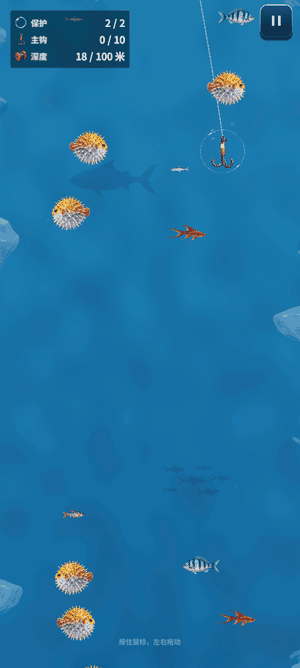
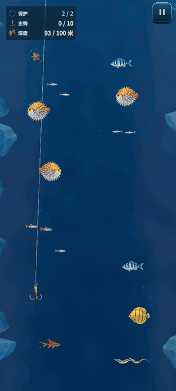
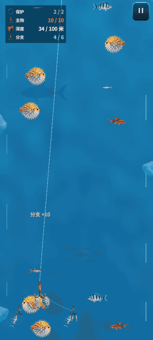
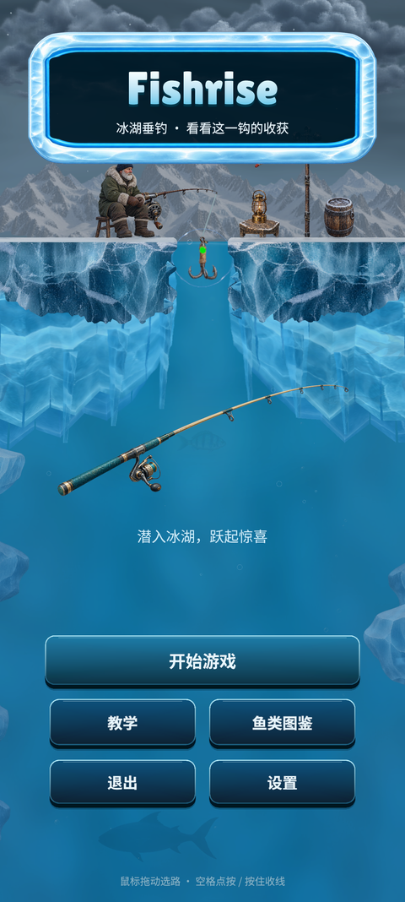
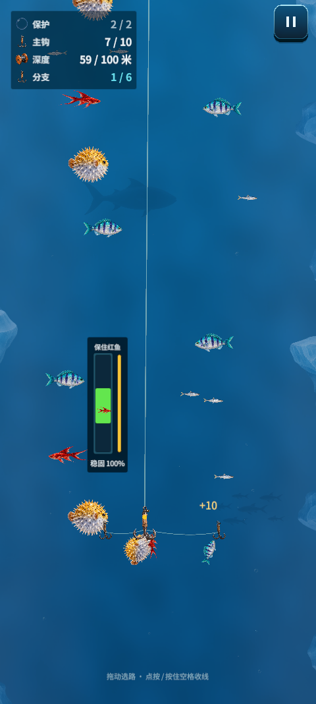
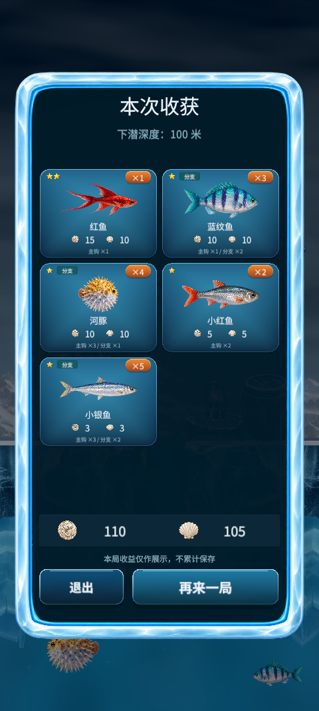

# Fishrise 飞鱼 玩法与画面

[项目首页](../../README.md) / [完整视频](Media/full-run.mp4) / [技术架构](Architecture.md)

## 下潜选路

鱼钩向冰湖深处下潜，玩家用拖动或倾斜改变横向位置。保护泡抵挡接触，声呐宝物则连续发出三跳声波，惊走周围小鱼，打开下潜路线。

## 收线与分散鱼钩

回程需要同时考虑路线和收线节奏。按住或松开输入会改变绿色控条的位置，让鱼标留在区间内可以维持稳固值；稳固值耗尽时会有鱼逃走。

分散鱼钩宝物让左右两侧各展开一只小钩。主钩容纳 10 条鱼，两个分钩各容纳 3 条一星鱼；主钩满载后加速返航。

## 出水与收获

鱼钩回到冰洞，镜头转向冰面。鱼获逐条跃出，随后按鱼种展示星级、数量、收益，以及主钩和分钩的来源。

## 界面与冰湖场景

菜单、教学、图鉴和设置沿用冰蓝配色与冰晶边框。水下用连续水色、光纹、气泡和鱼影视差表现深度，冰壁保留折射与受光细节。

  
  
  

## 操作

| 平台 / 模式 | 操作 |
| --- | --- |
| 电脑 | 鼠标左右拖动选路，上收时点按或按住空格收线 |
| 手机拖动 | 非 UI 区域拖动横移，短点按或原地按住收线，也可以另一根手指收线 |
| 手机倾斜 | 自然握姿校准后左右轻倾横移，点按或按住收线 |

菜单与暂停页提供操控模式、倾斜灵敏度、校准和声音选项。
