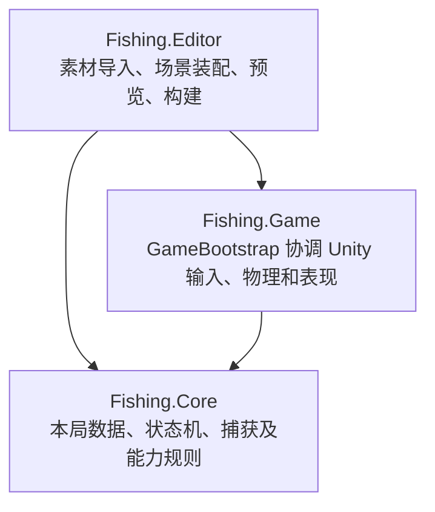
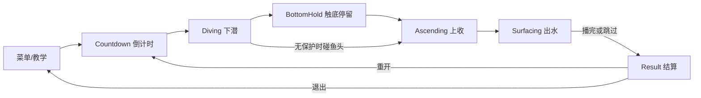

# 项目框架与优化指南

核对日期：2026-10-21。工程根目录：[FishingCasualGame](<G:/Unity Project/Casual Game/Casual Fishing/FishingCasualGame>)。Unity 固定为 2022.3.52f1，URP 2D，Android 竖屏，Legacy Input Manager。

本文按当前代码说明已经实现的结构，供接手调参和优化使用；完整设计约束见 [Architecture.md](<G:/Unity Project/Casual Game/Casual Fishing/FishingCasualGame/Docs/Architecture.md>)。

## 1. MVP 的当前结论

**开发版的核心玩法 MVP 已跑通，可以开始优化体验细节。Android 真机验收仍待完成。**

当前闭环：起始页／首次教学 → 倒计时 → 下潜避鱼 → 触底或提前上收 → 主钩及分支捕获 → 出水演出／跳过 → 结算 → 重开／返回菜单。保护、满载、暂停、声呐、分散鱼钩和七类鱼均已接入。

| 证据层级 | 已确认的结果 | 结论边界 |
| --- | --- | --- |
| Core 规则测试 | 45/45 通过 | 纯规则和边界行为 |
| Game 场景测试 | 38/38 通过 | 保存场景、实际 Physics2D、UI 回调和重开等集成 |
| 正常游戏帧 | 100 米，主钩 10＋分支 3＋3，250 金币／190 贝壳，16 条鱼完成约 2.32 秒演出 | 脚本提供横向目标和按钮回调，正常 FixedUpdate 推进；不是人工拖动验收 |
| Android 构建 | 0.2.0、IL2CPP、ARM64，构建 0 错误／0 警告，签名有效 | APK 已生成；本轮重新核对文件哈希与记录一致 |
| 人工和设备 | 仍待持续拖动、手机安装、触摸、听感、震动及性能检查 | 一次桌面注入拖动未产生横移，未记为通过 |

上述测试是已有的 2026-10-21 验证记录；本轮整理框架没有重新执行游戏测试。详见 [第四阶段验证报告](<G:/Unity Project/Casual Game/Casual Fishing/FishingCasualGame/Docs/Verification/presentation-checkpoint-20261021.md>)。当前相关 C# 文件修改时间早于这些最终测试记录。

## 2. 三层结构与总入口



程序集依赖是 Game → Core；Editor 引用 Game/Core。Core 的 asmdef 设置 `noEngineReferences=true`，不依赖场景、碰撞器或 Unity 资源。

| 职责 | 当前实现 | 你接手时从哪里看 |
| --- | --- | --- |
| 场景总入口 | 创建一局、装配对象、订阅事件、组织更新和清理 | [GameBootstrap.cs](<G:/Unity Project/Casual Game/Casual Fishing/FishingCasualGame/Assets/_Game/Scripts/Game/GameBootstrap.cs>) |
| Model：本局数据 | 深度、保护、时钟、捕获记录与派生收益 | [RunModel.cs](<G:/Unity Project/Casual Game/Casual Fishing/FishingCasualGame/Assets/_Game/Scripts/Core/RunModel.cs>) |
| Controller：规则裁决 | 状态切换、接触去重、主钩／分支分配、统一捕获 | [FishingFlowController.cs](<G:/Unity Project/Casual Game/Casual Fishing/FishingCasualGame/Assets/_Game/Scripts/Core/FishingFlowController.cs>) |
| View／Unity 适配 | 鱼、钩、环境、镜头、UI、特效、音效与物理查询 | `Fishing.Game` 中的各模块，见下表 |

`GameBootstrap` 是协调入口，具体规则、布局和动画分别放在对应模块中。当前对象之间通过直接引用和 C# 事件协作。

## 3. 场景、资产与目录

| 工程区域 | 内容和用途 |
| --- | --- |
| [Scenes](<G:/Unity Project/Casual Game/Casual Fishing/FishingCasualGame/Assets/_Game/Scenes>) | `Menu.unity`：正式起始页；`Main.unity`：直接 Play 检查一局。两场景均绑定 GameBootstrap |
| [Configs](<G:/Unity Project/Casual Game/Casual Fishing/FishingCasualGame/Assets/_Game/Configs>) | 全局规则、七鱼种、声呐、分支钩、UI 资源引用 |
| [Prefabs](<G:/Unity Project/Casual Game/Casual Fishing/FishingCasualGame/Assets/_Game/Prefabs>) | `Fish.prefab`、`Hook.prefab`、`Environment.prefab` |
| [Art](<G:/Unity Project/Casual Game/Casual Fishing/FishingCasualGame/Assets/_Game/Art>) | 已导入的鱼、环境、UI、中文字体与共享材质 |
| [Core](<G:/Unity Project/Casual Game/Casual Fishing/FishingCasualGame/Assets/_Game/Scripts/Core>) | 纯 C# 数据与规则 |
| [Game](<G:/Unity Project/Casual Game/Casual Fishing/FishingCasualGame/Assets/_Game/Scripts/Game>) | Unity 运行时适配与表现 |
| [Editor](<G:/Unity Project/Casual Game/Casual Fishing/FishingCasualGame/Assets/_Game/Scripts/Editor>) | 装配、导入、竖屏预览和 Android 构建工具 |
| [Tests](<G:/Unity Project/Casual Game/Casual Fishing/FishingCasualGame/Assets/_Game/Tests>) | EditMode 规则测试、PlayMode 场景测试 |
| [Verification](<G:/Unity Project/Casual Game/Casual Fishing/FishingCasualGame/Docs/Verification>) | 已保存的测试结果、运行采样、截图和构建记录 |

工程内素材足够运行。上一级 Arts 是源图目录，重新执行素材导入工具时才会读取。保留现有 `.meta`，以维持场景和配置的资源引用。

## 4. 一局如何运行



状态类在 [FlowStates.cs](<G:/Unity Project/Casual Game/Casual Fishing/FishingCasualGame/Assets/_Game/Scripts/Core/FlowStates.cs>)。满载由主钩数量派生；暂停是覆盖标记，保留原流程状态。

`GameBootstrap` 的更新分工：

1. `Start` 创建鱼池、主钩、镜头、能力视图、音效与 UI；Main 自动开始一局。
2. `BeginRun` 清理旧订阅与视图，创建新的 RunModel／Controller，把配置转成规则快照，生成鱼群并启动倒计时。
3. `Update` 读取拖动目标、处理返回键和安全区变化、显示倒计时。
4. `FixedUpdate → AdvanceGameplay` 统一推进规则与物理，顺序见下一节。
5. `LateUpdate` 跟随镜头并更新环境视差；暂停时冻结。
6. `OnDestroy` 解除订阅并恢复原 Physics2D 模拟模式。

## 5. 输入、物理、捕获和结算的数据流

```text
鼠标／触摸 → DragInput.TargetX
                       ↓
GameBootstrap.AdvanceGameplay(dt)
  → Flow.BeginStep：推进游戏时钟、深度、状态和能力
  → 移动鱼、主钩与分支；收集物理候选
  → Physics2D.SyncTransforms / Simulate
  → ContactDetector.Finish ＋ AbilityRig.Combine
  → 一个 ContactBatch（RunId / Step）
  → Flow.ResolveContacts：过滤、排序、去重、分配、提交
  → RunModel.Captures 新增唯一 CaptureRecord
  → 事件驱动挂鱼、HUD、灯色、音效和结算展示
```

必须保持的几个约定：

- **CaptureRecord 是捕获数量、容量使用和收益的唯一来源。** 挂鱼数量、飘字和结果卡片均由它读取。
- 主钩 ID 为 0，分支为 1/2。每条记录保留鱼实例、来源钩、鱼种、时间、深度和收益快照。
- 回调、扫掠和重叠先进入同一批次；规则在 Core 统一裁决。高速满载时仍可捕获路径上的小鱼。
- 同步上收候选先分配有效分支，再给主钩；分支余量与主容量分别计算，整批分配后再提交。
- 捕获事件发出时，记录已经提交；动画和声音接收该事件。
- 出水与跳过只改变表现阶段。结算由 `Settlement.Summarize` 汇总现有记录。
- 重开创建新的 RunId，并重置检测缓存、能力、挂鱼、镜头和表现；鱼及两条分支视图复用。

## 6. 各模块的修改入口

下表“代码入口”位于 [Game 脚本目录](<G:/Unity Project/Casual Game/Casual Fishing/FishingCasualGame/Assets/_Game/Scripts/Game>)，规则模块位于 [Core 脚本目录](<G:/Unity Project/Casual Game/Casual Fishing/FishingCasualGame/Assets/_Game/Scripts/Core>)。

| 你想优化的内容 | 代码入口 | 关联资产或数据 |
| --- | --- | --- |
| 相对拖动、跟手和 UI 触点过滤 | `DragInput`、`HookMotor` | FishingConfig 的横移速度、跟随方式 |
| 下潜／上收节奏、保护、满载 | `FlowStates`、`FishingFlowController`、`RunModel` | FishingConfig → FishingRules |
| 鱼种数量、深度、鱼群与通道 | `FishSpawner` | FishingConfig.depthBands、七份 FishDefinition |
| 鱼的大小、朝向、判定和挂点 | `FishActor`、`HookMotor`、`ContactDetector` | FishDefinition、Fish/Hook 预制体 |
| 镜头跟随、转向缓动、水面过渡 | `CameraRig` | FishingConfig 的水域半宽与单位比例 |
| 冰壁、人物姿态、鱼竿和背景鱼影 | `FishingSceneView` | Environment.prefab 与其子物体 |
| 声呐次数、范围和逃离行为 | Core 的 `SonarAbility`、Game 的 `AbilityRig`／`FishActor` | SonarConfig |
| 分支容量、展开、跟随和判定 | Core 的 `BranchHookController`、Game 的 `AbilityRig`／`BranchHookView` | BranchHookConfig |
| 菜单、HUD、安全区和暂停布局 | `GameUi`、`AbilityHud`、`UiWidgets` | GameUiAssets、中文字体 |
| 教学文字与翻页 | `UiText`、`TutorialView` | GameUiAssets 的教学图片 |
| 结算卡片、滚动与来源标记 | `ResultView`、Core 的 `Settlement` | CaptureRecord → FishSummary |
| 出水曲线、鱼大小、飘字和跳过 | `SurfacePresentation` | 捕获记录、鱼图、surfacingSeconds |
| 捕获飘字、保护气泡、速度线 | `GameplayFeedbackView` | 共享 UI 图与游戏时钟 |
| 挂鱼摆动和捕获缩放 | `FishActor` | 鱼嘴挂点、来源钩挂点 |
| 音效、震动和设置 | `GameFeedback`、`FeedbackSettingsView` | 程序合成短音、PlayerPrefs 设置 |

**UI 当前由代码在运行时生成。** 停止 Play 后，场景里没有一套完整的 HUD／结算 Canvas 供直接排版。布局入口在 GameUi、UiWidgets、ResultView 等脚本；图标和字体引用在 GameUiAssets。Play 中临时拖动 UI 只用于观察，正式修改需落到对应代码。可视化 UI 预制体迁移属于后续可选调整。

## 7. 优先通过配置调整的参数

### 全局配置

资产：[FishingConfig.asset](<G:/Unity Project/Casual Game/Casual Fishing/FishingCasualGame/Assets/_Game/Configs/FishingConfig.asset>)。

| 内容 | 字段 | 当前值 |
| --- | --- | --- |
| 深度与底部区 | maxDepth / bottomZoneOffset | 100 米 / 最后 4 米 |
| 下潜、末段减速距离 | diveSpeed / slowdownDistance | 6 / 5 |
| 上收与满载倍率 | ascentSpeed / fullMultiplier | 6.5 / 5 倍 |
| 停留、倒计时、出水演出 | bottomHoldSeconds / countdownSeconds / surfacingSeconds | 1.2 / 3 / 2.3 秒 |
| 主容量、保护、受击无敌 | mainCapacity / protectionCharges / invulnerabilitySeconds | 10 / 2 / 1 秒 |
| 水域半宽、横移速度 | halfWidth / horizontalSpeed | 4.5 / 13.5 |
| 拖动方式 | followTouchPoint | false，使用相对拖动 |
| 随机种子、通道宽度倍率 | randomSeed / passageWidthMultiplier | 2718 / 2.5 |
| 四段鱼群 | depthBands | 0–25、25–50、50–75、75–100 米；12/13/14/15 条，共 54 条 |

规则快照在新局建立时生成，修改这类值后重开检查。横移、镜头和部分视觉参数仍由 Game 层读取，修改后也应在新局验证。调整最大深度时，同时检查 depthBands 和各鱼种的允许深度；鱼群过宽、行数不足或没有合适深度时，生成器会报告无效配置。

### 鱼种、能力和资源

- 七鱼种资产为 `Fish_blue/red/small/puffer/yellow/eel/silver.asset`。金币／贝壳、稀有度、深度、游速、大小均在对应 FishDefinition 中；小红鱼和小银鱼使用 `isSmall` 标记。
- 替换鱼图后检查 Sprite 的 PPU、默认右朝向、`headPosition/headRadius` 和 `mouthPosition`，并验证左右游动与挂钩对齐。
- [SonarConfig.asset](<G:/Unity Project/Casual Game/Casual Fishing/FishingCasualGame/Assets/_Game/Configs/SonarConfig.asset>)：2 次、冷却 4 秒、半径 4 米、声波 0.4 秒、受惊 2.5 秒／3 倍游速，仅非底部区下潜可用。
- [BranchHookConfig.asset](<G:/Unity Project/Casual Game/Casual Fishing/FishingCasualGame/Assets/_Game/Configs/BranchHookConfig.asset>)：1 次、2 钩×3 条，展开 0.25 秒、跟随平滑 0.06 秒、范围比例 0.18；大鱼退回风险 `breakOnLarge` 默认关闭。
- [GameUiAssets.asset](<G:/Unity Project/Casual Game/Casual Fishing/FishingCasualGame/Assets/_Game/Configs/GameUiAssets.asset>)：共享 UI 图片和中文字体引用。

## 8. 时间、事件和保存范围

- GameClock 提供暂停感知的 dt，RunModel.GameTime 作为规则与冷却的时间基准。
- 普通暂停保留原状态；应用切后台另有时钟冻结，覆盖倒计时、出水与结果动画。Editor 已测试回调路径，手机系统行为仍需实测。
- HUD 读模型事件；结算读捕获快照；音效接收已提交事件。新动画继续接入现有时钟和重开清理入口。
- 当前是单局体验型 MVP：金币／贝壳用于本局统计。PlayerPrefs 保存首次教学、音效与震动开关。

## 9. 工具与回归入口

| 工作 | 工具／测试入口 |
| --- | --- |
| 直接检查玩法 | 打开 Main.unity → Play |
| 检查起始页与首次教学 | 打开 Menu.unity → Play；教学记忆由 PlayerPrefs 管理 |
| 竖屏预览 | Unity 菜单 Fishing / Portrait Game View；已有 450×800、450×975、450×1050 检查 |
| 纯规则回归 | Test Runner 的 Fishing.Core.Tests，当前 45 项 |
| 场景与物理回归 | Test Runner 的 Fishing.Game.Tests，当前 38 项 |
| 编译与语义定位 | Unity Console／编译状态、Rider 符号和诊断 |
| Android 构建 | Fishing / Build Android APK，使用 Unity Hub 随版本的 Android 工具链 |

装配工具用于导入和重建对应阶段资产。你手动调整了预制体、鱼群或布局之后，按需调用对应工具并检查差异；其中一些工具会重新写入该阶段的默认参数。

输入后端保持 Legacy Input Manager。启动时若 Input System 包询问是否启用新后端并重启，选择 **No**；改变后端后先重启再构建。

## 10. 接下来建议推进的顺序

1. **固化当前基线。** 工作区还有前几阶段的未提交代码、素材和记录，调参前保存为一次 Git 提交，方便对照和回退。
2. **你先连续手玩几局。** 优先确认持续拖动能可靠响应、横移跟手程度、鱼头碰撞直觉、保护提示、满载返航节奏、能力按钮位置和结算可读性。输入是第一项，因为此前注入拖动没有形成有效验收。
3. **做手机安装与体验检查。** 安装 [0.2.0 APK](<G:/Unity Project/Casual Game/Casual Fishing/FishingCasualGame/Builds/Android/CasualFishing-0.2.0-arm64.apk>)；验证完整单局、两能力、暂停／后台恢复、完整演出／跳过、重开、音效与震动。
4. **有测量后再收敛性能。** 当前 ContactBatch 的快照复制、HUD 字符串更新、纹理／字体内存与包体是可检查点，尚无设备测量，不能据此认定为瓶颈。当前 APK 为 Development，约 119.9 MiB。
5. **按需要补工具与表现。** FR-16 的成套 Development 调试面板尚未完成，固定种子已在配置里；独立鱼尾动画、镜头拉伸和更完整的水下氛围也可后续细化。

每轮优先调整一个模块，记录改前／改后参数和体验；规则变化检查 Core，移动或判定变化检查物理路径，界面变化检查三比例和中文显示。完成一个检查点后再构建需要上手机的新包。

## 11. 一轮调整后的最小验收

- [ ] 连续拖动、松手、重新按下及 UI 起始触点都正确。
- [ ] 正常触底和无保护提前上收都能结算。
- [ ] 主钩 10 条后满载加速；分支容量独立，来源统计一致。
- [ ] 声呐只影响小鱼；暂停和重开清理能力状态。
- [ ] 完整播放与点击跳过得到相同的收获与收益。
- [ ] 暂停、切后台恢复、重开、回菜单没有旧鱼或重复事件。
- [ ] 三种竖屏比例、中文、按钮和滚动卡片可用。
- [ ] C# 修改后完成编译及相关测试；设备结论另外记录。
