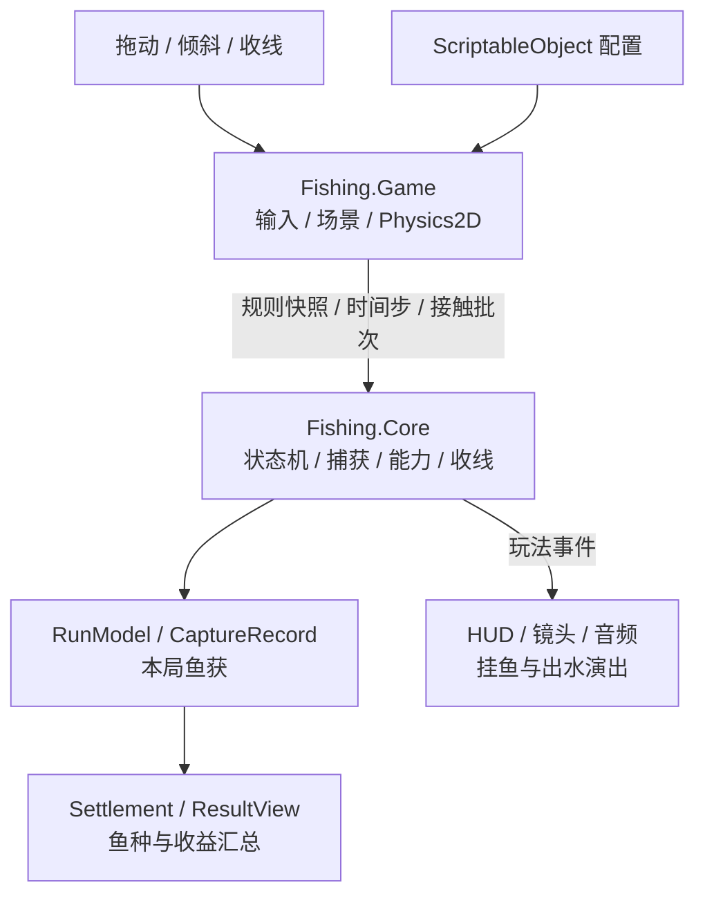

# Fishrise 飞鱼

一款以冰湖垂钓为主题的竖屏 2D 休闲游戏。

Unity 2022.3.52f1 / C# / URP 2D / Android

[完整演示](Docs/Portfolio/Media/full-run.mp4) / [技术架构](Docs/Portfolio/Architecture.md) / [玩法与画面](Docs/Portfolio/Demo.md)

## 游戏演示

<table>
  <tr>
    <th>下潜与声呐</th>
    <th>收线与分散鱼钩</th>
    <th>出水与收获</th>
  </tr>
  <tr>
    <td></td>
    <td></td>
    <td></td>
  </tr>
</table>

鱼钩自动下潜，玩家在鱼群之间选择路线。上收时，横移决定能碰到哪些鱼，按住或松开收线则影响控条的位置。让鱼标留在绿色区间内，就能稳住鱼获，把它们带回冰面。

声呐宝物会连续释放三跳声波，惊走附近小鱼；回程拾取分散鱼钩后，两侧各展开一只小钩。主钩最多容纳 10 条鱼，两个分钩各容纳 3 条一星鱼，主钩满载后会加速返航。

## 技术特点

### 分层架构与 MVC 职责划分

工程采用 Core / Game 分层，玩法按 MVC 思路划分模型、视图和控制职责。`Fishing.Core` 使用纯 C# 管理规则与本局数据，`Fishing.Game` 连接输入、Physics2D、镜头与界面。

| 职责 | 对应实现 | 作用 |
| --- | --- | --- |
| Model | `RunModel` / `CaptureRecord` / `ReelingModel` | 保存单局状态、鱼获和收线数据 |
| View | `GameUi` / `ResultView` / `ReelingView` | 根据模型数据呈现 HUD、收线控条和结算 |
| Controller | `FishingFlowController` / `GameBootstrap` | 推进规则与接触裁决，接入输入并协调场景表现 |

`GameBootstrap` 同时承担组合根（Composition Root），在 `Start` 和 `BeginRun` 中装配输入、模型和视图。ScriptableObject 配置在开局时转换为规则快照，Game 通过显式时间步、输入意图和接触批次驱动 Core。

### 多钩接触统一裁决

多个钩可能在同一物理步碰到同一条鱼。主钩和分钩的触发回调、移动扫掠、步末重叠先组成 `ContactBatch`，规则层去重和排序后再分配容量。分钩装满时可以回退主钩，移动扫掠则补充加速返航途中的接触。

### 鱼获记录贯穿挂鱼与结算

一条鱼从挂上钩到出现在结算卡片，都由 `CaptureRecord` 记录鱼种、来源钩和捕获时的价值。HUD、挂点和容量读取这份留存记录；逃鱼时移除对应鱼获并整理挂点，出水演出和跳过演出沿用同一份结算数据。

### 分鱼种对象池与随机鱼群

七种鱼各有独立 Prefab，鱼池按 `FishDefinition` 分类复用。每局在四段深度分配 54 条鱼，用种子控制聚簇、泳道和通道布局。鱼群与技能宝物采用独立随机流，支持固定种子重现同一布局。

### 拖动、倾斜与收线输入

拖动模式通过手势判断区分横移、点按和原地按住，拖动优先，也支持另一根手指收线。倾斜模式把自然握姿校准、死区和滤波后的重力采样转换为横移意图。两种模式共用收线规则，电脑端保留鼠标和空格操作。

### 冰湖表现与出水衔接

URP 2D 材质表现冰壁折射、边缘受光和水下光纹。镜头根据下潜与上收调整跟随位置，临近水面切换到冰面构图。鱼线连接竿尖、冰洞和钩顶，捕获反馈、鱼获出水及结算卡片由玩法事件驱动。

## 架构概览

运行时程序集依赖方向为 `Fishing.Game → Fishing.Core`。Core 禁用 Unity 引用，配置、物理和传感器采样留在 Game。

[查看设计模式、模块关系和单局状态机](Docs/Portfolio/Architecture.md)

## 画面

  
  
  

## 代码入口

| 模块 | 入口 |
| --- | --- |
| 场景与单局生命周期 | [GameBootstrap](Assets/_Game/Scripts/Game/Bootstrap/GameBootstrap.cs) |
| 状态机与接触裁决 | [FishingFlowController](Assets/_Game/Scripts/Core/FishingFlowController.cs) / [ContactDetector](Assets/_Game/Scripts/Game/Fishing/ContactDetector.cs) |
| 鱼获与结算 | [RunModel](Assets/_Game/Scripts/Core/RunModel.cs) |
| 收线控条与逃鱼 | [ReelingModel](Assets/_Game/Scripts/Core/ReelingModel.cs) |
| 鱼群生成与对象池 | [FishSpawner](Assets/_Game/Scripts/Game/Fish/FishSpawner.cs) |
| 触摸与倾斜 | [Input](Assets/_Game/Scripts/Game/Input/) |
| 声呐、分散钩与宝物 | [Core 能力](Assets/_Game/Scripts/Core/AbilityController.cs) / [场景表现](Assets/_Game/Scripts/Game/Abilities/) |

打开源工程

安装 Git LFS，克隆后执行 `git lfs pull`。使用 Unity 2022.3.52f1 打开仓库根目录，运行 `Assets/_Game/Scenes/Menu.unity`。

[操作方式与工程入口](Docs/Portfolio/Running.md)

图像、音频和字体的来源见 [素材说明](Docs/Portfolio/Sources.md)。
