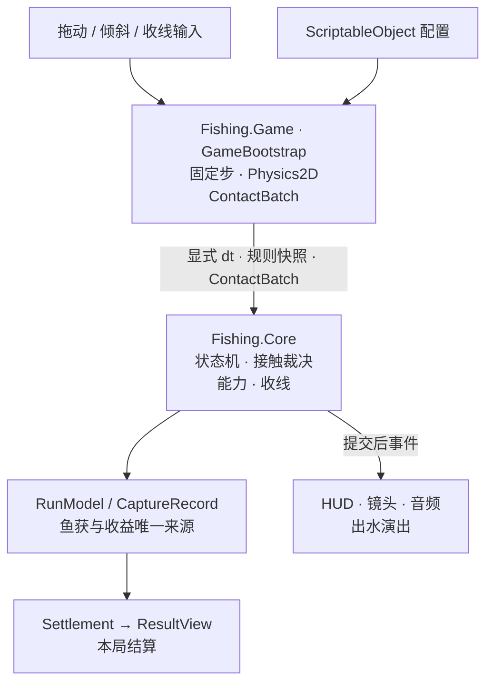

<div align="center">

# Fishrise · 冰湖垂钓

**下潜选路，稳住鱼获，把这一钩的收获带回冰面。**

Unity 2022.3.52f1 · C# · URP 2D · Android 竖屏


[架构图谱](Docs/Portfolio/Architecture.md) · [运行与构建](Docs/Portfolio/Running.md) · [完整录屏](Docs/Portfolio/Media/full-run.mp4) · [验证说明](Docs/Portfolio/Verification.md)

</div>

## 项目简介

Fishrise 是一款竖屏 2D 休闲钓鱼游戏。玩家在下潜时避让鱼群、拾取声呐宝物，上收时横向选路并控制收线节奏，利用分散鱼钩扩大收获，最后在冰面观看出水演出与本局结算。

项目侧重 **Unity/C# Gameplay、规则与表现分离、物理接触裁决、移动端输入及完整单局流程**。七鱼种、中文教学、图鉴、暂停设置、冰湖场景、水下表现和事件音频均已接入。

## 玩法演示

<table>
  <tr>
    <th>下潜与声呐</th>
    <th>收线与分散钩</th>
    <th>出水与结算</th>
  </tr>
  <tr>
    <td></td>
    <td></td>
    <td></td>
  </tr>
</table>

以上来自 **2026-10-26 的实际 Editor 运行**。录制脚本提供横移目标和收线意图，原游戏完成物理、捕获、能力与结算；本局到达 100 米，主钩 10 条、分钩 5 条，结算 110 金币 / 105 贝壳。详见 [演示方式与逐帧记录](Docs/Portfolio/Demo.md)。GIF 无声，不代表真机触控或性能验收。

## 已实现内容

| 系统 | 当前行为 |
| --- | --- |
| 单局流程 | 菜单 / 首次教学 → 倒计时 → 下潜 → 触底或提前返航 → 上收 → 出水 → 结算；支持暂停、重开和返回菜单 |
| 双操控模式 | 拖动优先的无分区手势；倾斜校准、死区、灵敏度设置及无传感器回退；电脑保留鼠标 / 空格操作 |
| 捕获与保护 | 独立鱼头碰撞；回调、扫掠和末端重叠统一处理；两次保护、无敌期、持续接触去重；主钩容量 10，满载加速返航 |
| 收线挑战 | 惯性控条、鱼获数量带来的难度变化、稳固值与逃鱼；鱼获变化同步到挂点、HUD 和结算 |
| 拾取能力 | 声呐宝物触发三跳声波，惊走附近小鱼；分散钩宝物在上收时展开左右小钩，各可容纳 3 条一星鱼 |
| 鱼群 | 七种鱼、四段深度、54 条预算；每局随机种子、聚簇泳道与可复现配置；按鱼种隔离的对象池 |
| 表现与界面 | 跟随镜头、连续鱼线、冰壁折射与水下氛围、捕获反馈、鱼获出水、按来源汇总的卡片结算、只读图鉴与安全区适配 |
| 声音与设置 | 场景音乐切换、环境循环、事件音效，音效 / 震动开关及操控偏好保存 |

金币和贝壳用于**本局结算展示**，当前没有跨局经济、养成或在线系统。

## 架构概览



这是运行数据流。运行时项目程序集依赖方向为 **`Fishing.Game → Fishing.Core`**；Core 设置 `noEngineReferences = true`，不依赖 Unity 对象、输入或物理 API。

三个实现重点：

- **把规则留在 Core**：由 Game 显式传入时间、输入意图和完整物理步批次，规则测试无需加载场景。
- **接触先收集，再统一裁决**：物理回调不直接计入鱼获；统一处理去重、稳定排序、分钩优先、主钩回退和容量边界。
- **一份记录贯穿捕获到结算**：HUD、挂鱼、分钩容量、逃鱼和收益读取同一份留存鱼获，表现完成或跳过都不重复发奖。

[完整图谱](Docs/Portfolio/Architecture.md) 包含程序集依赖图、模块图、固定步时序图、单局状态机和当前取舍。

## 代码阅读入口

| 想看什么 | 从哪里开始 |
| --- | --- |
| 场景组合与单局生命周期 | [GameBootstrap.cs](Assets/_Game/Scripts/Game/Bootstrap/GameBootstrap.cs) |
| 状态机与接触裁决 | [FishingFlowController.cs](Assets/_Game/Scripts/Core/FishingFlowController.cs) / [FlowStates.cs](Assets/_Game/Scripts/Core/FlowStates.cs) |
| 鱼获数据与结算 | [RunModel.cs](Assets/_Game/Scripts/Core/RunModel.cs) |
| 收线与逃鱼 | [ReelingModel.cs](Assets/_Game/Scripts/Core/ReelingModel.cs) |
| 鼠标、触摸与倾斜 | [Input/](Assets/_Game/Scripts/Game/Input/) |
| 物理候选与扫掠 | [ContactDetector.cs](Assets/_Game/Scripts/Game/Fishing/ContactDetector.cs) |
| 鱼群生成与对象池 | [FishSpawner.cs](Assets/_Game/Scripts/Game/Fish/FishSpawner.cs) |
| 声呐、分钩与宝物 | [Core 能力](Assets/_Game/Scripts/Core/AbilityController.cs) / [Game 适配](Assets/_Game/Scripts/Game/Abilities/) |
| 规则和场景回归 | [EditMode 测试](Assets/_Game/Tests/EditMode/) / [PlayMode 测试](Assets/_Game/Tests/PlayMode/) |

```text
Assets/_Game/
├── Scripts/
│   ├── Core/       纯 C# 规则、状态机和本局模型
│   ├── Game/       按系统划分的 Unity 适配与表现
│   └── Editor/     装配、导入、预览与构建工具
├── Configs/        玩法、鱼种、能力、UI 和音频配置
├── Prefabs/        主钩、七鱼种与共用环境
├── Scenes/         Menu / Main
├── Art/            现用图像、材质、Shader 和字体
├── Audio/          音乐、环境音、事件音效及来源
└── Tests/          EditMode / PlayMode
```

## 打开项目

安装 Git LFS，克隆后执行 `git lfs pull`；使用 **Unity 2022.3.52f1** 打开仓库根目录，再打开 `Assets/_Game/Scenes/Menu.unity` 进入 Play。

电脑上按住鼠标左右拖动选路，上收时点按 / 按住空格收线。手机支持拖动或校准后的倾斜操控。完整环境、构建入口和 Both 输入后端说明见 [运行与构建](Docs/Portfolio/Running.md)。

## 验证状态

2026-10-26 本次重新检查：Core EditMode **100/100**；Game PlayMode **173/177，4 项失败**；实际受控单局已从菜单到达结算。失败项涉及鱼头 / Prefab 断言和按钮覆盖计数，具体预期、实测值和原报告见 [验证说明](Docs/Portfolio/Verification.md)。

本次未构建新 APK，也没有测量当前版本的真机 FPS、内存、GC、触控延迟或倾斜手感。目标帧率设置为 120 不代表已实现或测得 120 FPS。

## 素材与开发说明

本仓库展示玩法、架构、Unity 资源接入和验证过程。开发使用 AI 辅助迭代；需求、实现取舍与验收由作者把关。第三方图像、字体和音频分别记录来源，不声明为项目原创素材，也不统一套用代码开源许可。

来源与使用范围见 [素材说明](Docs/Portfolio/Sources.md)、[音频来源](Assets/_Game/Audio/Sources.md) 和 [字体记录](Assets/_Game/Art/Fonts/README.md)。
